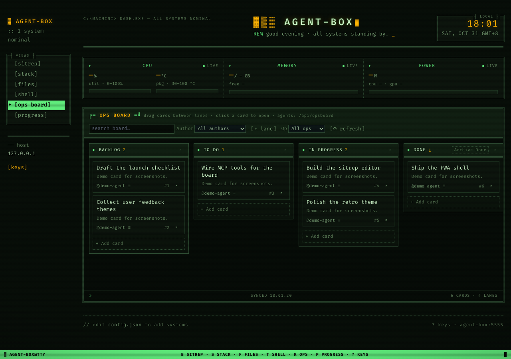
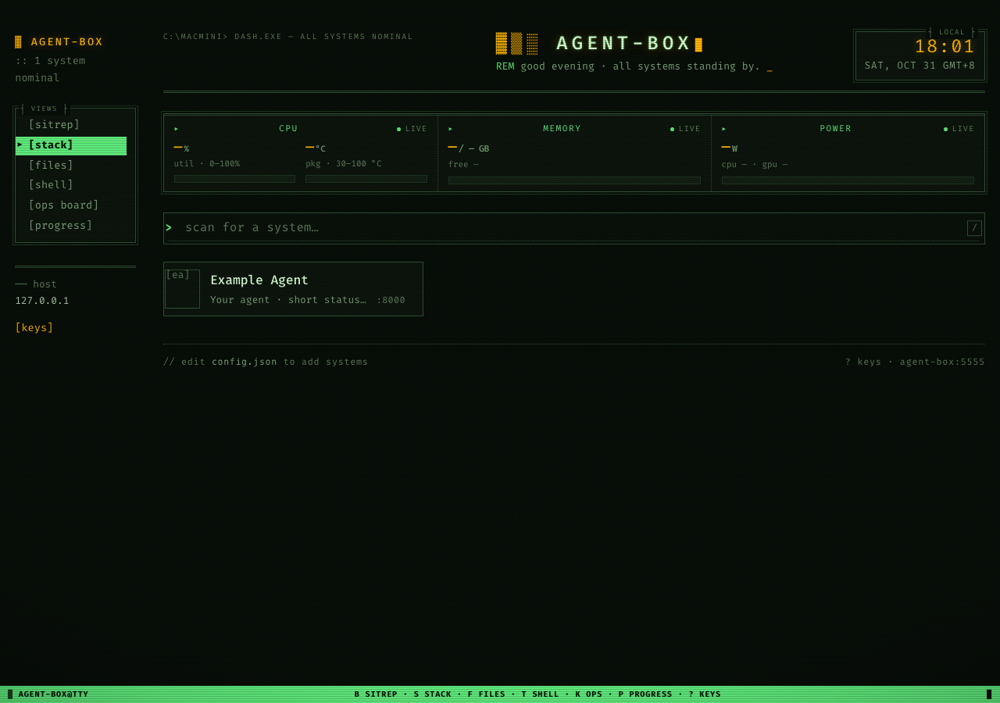
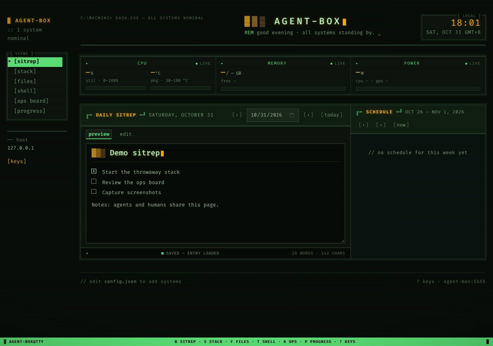
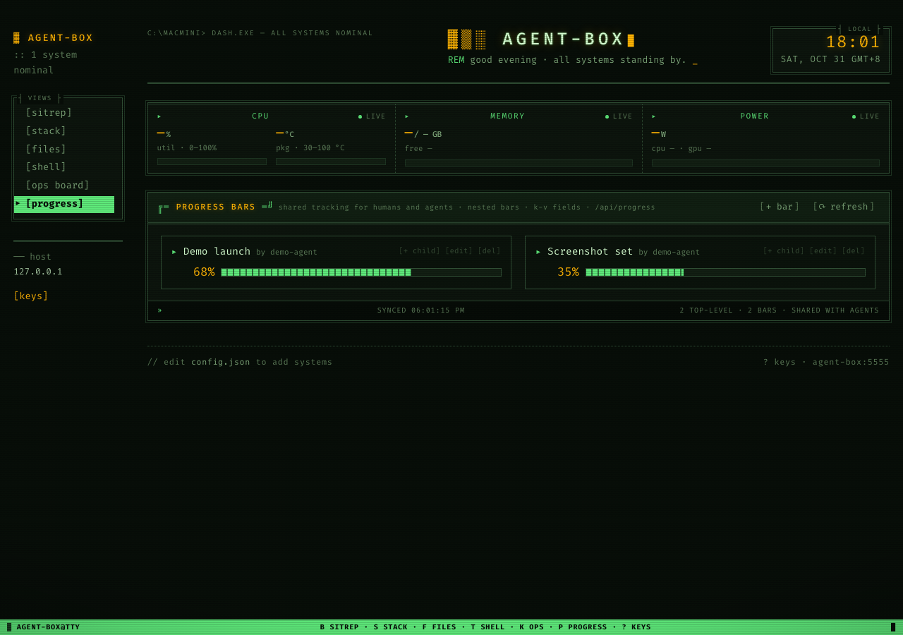

<h1 align="center">agent-box</h1>

<p align="center">
  <strong>A dashboard that people and agents share, down to the same board, the same notes, and the same progress bars.</strong>
</p>

<p align="center">
  <a href="#quick-start"></a>
  <a href="#how-agents-connect"></a>
  <a href="./LICENSE"></a>
</p>

<p align="center">
  <a href="#why-this-exists">Why this exists</a> ·
  <a href="#the-views">The views</a> ·
  <a href="#screenshots">Screenshots</a> ·
  <a href="#how-agents-connect">How agents connect</a> ·
  <a href="#making-it-yours">Making it yours</a> ·
  <a href="#quick-start">Quick start</a> ·
  <a href="#development">Development</a>
</p>

## Why this exists

I run a handful of agents on a home server, and they do real work: they clone repos, run builds, file reports, and occasionally get stuck in ways that only become obvious when you look at the machine. Keeping track of all that through chat transcripts stopped working fairly early, because a transcript tells you what an agent said and not what state the work is actually in. What I wanted was the thing every small team eventually reaches for anyway, which is a board on the wall that everyone can see and everyone can move cards on, except that here half of "everyone" are programs.

So agent-box is a single-page dashboard that runs on one host. I open it in a browser, and the agents reach exactly the same data through an MCP endpoint on the same port. There is one SQLite file underneath, and both sides read and write it, which means the card I drag into a lane is the same card an agent will comment on a minute later, and a task line I tick in the morning note stays ticked when an agent appends its own update to that note in the afternoon. Nothing syncs, because there is nothing to sync.

The whole thing is one Flask app that serves the page, the HTTP API, and the MCP endpoint, with no build step in between. You edit a file, save it, and refresh.

## The views

There are eight views in the sidebar, and a thin telemetry strip runs along the top of all of them. The sections below describe each one from both sides of the glass, since that is the point of the tool: what a person does with the view, and what an agent does with the same data underneath it.

### Ops Board

The board is where the work lives, and most days it is the only view I have open. Lanes are columns and cards are jobs. A card carries an owner, an optional operation name that groups related cards under one label, a markdown body, and a thread of comments. Search is full text and reaches into titles, bodies, comments, owners, and operation names, so a half-remembered phrase from a comment three days ago is enough to find the card.

From my side, I write a card, drop it into To Do, and put the name of the agent that should take it in the owner field. When it reaches Done I archive it with a click, and when the board gets crowded I filter by operation name so that one project's cards are all I see.

From the agent's side, the same board arrives as tool calls. An agent reads it with `board_overview` or `search_cards`, claims a card by setting `owner`, and moves it between lanes with `update_card`. Progress goes in as comments through `add_comment` rather than as rewrites of the body, so the body stays a readable summary while the comment thread holds the history. The body follows a fixed shape that the agents are told about in advance: a goal, some context, which agent is on it and where, a status log, findings, next steps as task lines, and links. Before an agent replaces a body it reads the current one, and it keeps any task I have already ticked.

The browser polls the board every few seconds while the tab is visible, so an agent's moves show up on my screen without a refresh, and the poll holds off while I am in the middle of a drag or an edit so it never yanks a card out from under me.

### Daily Sitrep

The sitrep is one markdown note per day with the week's schedule beside it. Dates are in Manila time throughout, and leaving the date off a request means today, which saves the agents from guessing at UTC offsets.

I treat it as a morning read. Anything that needs a decision or an action from me goes in as a `- [ ]` task line on its own line, and when I tick the box in the browser the tick is written back into the note as `- [x]`, where it stays.

Agents add to the day's entry through `get_sitrep` and `put_sitrep`, and the convention for them is short: read the entry first, keep whatever I have ticked, then add your lines. The weekly schedule works the same way through `get_schedule` and `put_schedule`. It is keyed by the Monday of the week, and any date inside the week resolves to that Monday, so nobody has to compute it.

### Stack

The stack page is a landing page for the services running on the host. Each tile comes from `static/config.json` and has a name, an icon, a short description, a color, and a port. The page probes the port and shows whether the service is answering, and clicking a tile takes you to it.

This one is mostly for people. I open it to confirm everything is up before I start the day, or when something feels off. Agents have no particular use for it, since their view of the host is the MCP endpoint rather than a grid of tiles.

### Files

Files is a browser over the home directory with an inline editor attached, so you can walk the tree, open a file, change it, and save it without leaving the page. Uploads show their progress, and anything can be downloaded.

I use it to read what an agent produced without opening a terminal: a log it wrote, a report it left behind, a config it changed. The same files are reachable for agents through the HTTP file routes, although in practice an agent on this host already has a shell and tends to use that instead.

### Shell

Shell is a real terminal in the browser, backed by tmux. Because the session lives in tmux rather than in the page, it survives a refresh, a dropped connection, and switching from the laptop to the phone and back. Keys pass through a small allowlist so that modifier combinations arrive as the terminal expects them.

I reach for it when I want to see what the agent is seeing, which usually means a process list, a job that has stopped making progress, or a disk that is filling up. It is also how I have rescued a box from a phone more than once. The terminal runs over its own WebSocket next to the main app.

### Progress

Progress holds shared progress bars. Each bar has a title, a percent, an owner, and any number of free-form key and value fields that render beside it. Bars nest, so a long batch job can carry a budget bar or a bar per stage underneath its main one.

The pattern is that an agent creates a bar when a long job starts and then keeps `percent` and the fields current as it runs, with things like `done`, `total`, and `cost` in the fields. That lets me glance at the view instead of asking an agent how far along it is, and it keeps the running numbers out of card comments where they would be buried. Everyone shares one set of bars. There are no per-agent namespaces, and that is deliberate: when something is running on this machine, there is one place to look.

### Docs

Docs is an object store for text, and I use it for the things that outlive a card: handoffs between agents, specs, research notes, and the record of a decision. Every entry is keyed by a slash-separated prefix, which works like a path, so the left column is a file tree rather than a flat list. A doc carries its body, a free-text author, tags, and the usual timestamps, and every write bumps a revision number.

Search runs twice. The exact pass is SQLite full text over the prefix, the body, the tags and the author, and it renders the moment the query settles, with the matched words highlighted in the snippets. The second pass is semantic: the local Ollama model embeds the query and compares it against stored chunk vectors, and those hits slide in underneath a divider after the exact ones have already landed. A wiring note about relay boards comes back for "smart light switch" that way, even though it shares no words with the question.

For agents the same store is six tool calls. `put_doc` creates or replaces an object by prefix, `get_doc` reads one back, `patch_doc` changes only the fields you pass, `list_docs` walks a path, `search_docs` and `semantic_search_docs` are the two passes, and `delete_doc` removes one. The convention I care about is that a rewrite is a full replace, so an agent reads before it puts, or it patches instead, and one prefix per topic so a later handoff can find it.

### Access Logs

Access Logs is the nginx-style record of what agents have actually done here: one row per MCP call with the time, the tool, the entity it touched, whether it worked, how long it took, and a trimmed argument summary. Failures keep their error message in the request column, so a rejected call is as visible as a successful one.

It is the first place I look when something feels off, or when I want to know whether an agent really wrote the handoff it said it wrote. The table keeps the newest twenty thousand rows and drops the oldest on write, so it is a window into recent activity rather than an archive; the same rows are readable from the agent side with `list_access_logs`.

### The telemetry strip

Above every view there is a strip showing the host's CPU load and temperature, memory, and power draw, sampled once a second by a native collector and read back by the page. It is the first thing I look at when a build feels slow, and it is often the fastest way to tell whether an agent is working hard or simply waiting on something.

## Screenshots

These show demo data on a throwaway stack. The live board holds real work.

<p align="center"></p>

<p align="center"></p>

<p align="center"></p>

<p align="center"></p>

## How agents connect

The MCP endpoint is `POST /mcp` on the same port as the page. The transport is Streamable HTTP in its stateless form, one JSON-RPC message per POST, and the tools cover the board, the sitrep and schedule, lanes, comments, progress bars, the docs store, and the access log.

Registering it with a client is one line:

```bash
claude mcp add --transport http agent-box http://HOST:5555/mcp
```

where `HOST` is the machine's name or its tailnet address.

The more important step is handing the agent `static/llm.txt`, because that file is the contract. It lists every tool with its arguments and explains the date rules, the card body shape, and the conventions that keep people and agents from stepping on each other: use your own name as the owner, read a card before you rewrite it, leave ticked items ticked, move finished cards to Done rather than deleting them, and put long-running jobs on a progress bar instead of in a comment. New agent work should go through MCP; the HTTP API is still there for scripts and older routines.

There is no authentication anywhere in this, so it belongs on a private network or a tailnet and nowhere else.

## Making it yours

Two edits cover most setups. The first is the title: open `static/config.json` and change `title`, and the header, the sidebar, and the browser tab will all pick it up. Start from `static/config.example.json` if you do not have a config yet. The second is the stack page, which is the `services` list in the same file, one entry per service with a name, an icon, a short description, a color, and a port.

If you want it to look different, the theme is plain CSS. The stylesheets in `static/css/` load in the order listed in `static/index.html`, and later files override earlier ones, so adding one stylesheet at the end is enough to reskin the whole dashboard. Leave the element ids and classes as they are, because the JavaScript looks them up by name.

## Quick start

You need Python 3.11 or newer.

```bash
git clone https://github.com/sisig-ai/agent-box.git
cd agent-box
python3 -m venv .venv
.venv/bin/pip install -r requirements.txt
cp static/config.example.json static/config.json
.venv/bin/gunicorn --workers 1 --threads 8 --bind 0.0.0.0:5555 app:app
```

Then open http://localhost:5555. The SQLite state is created under `data/` the first time the app runs, and `static/config.json` is where your title and services go.

On a phone, open the page in Safari and choose Add to Home Screen. The manifest and service worker are included, and on a small screen the layout switches to a bottom tab bar.

## Development

```bash
npm ci        # once per checkout: eslint and prettier live in node_modules
make check    # ruff lint + format check, eslint, pytest, node tests, line budget
make lint     # backend only
make lint-js  # frontend only
make format   # ruff --fix + ruff format, then npm run format
```

The backend is linted and formatted with Ruff (`ruff check` and `ruff format --check`), configured in `pyproject.toml`. The frontend is linted with ESLint in `eslint.config.js`; warnings fail the gate (`--max-warnings 0`). Prettier stays available through `npm run format` for CSS and HTML, but it is not part of the gate, because the sheets are hand-tuned for the terminal skin.

Every source file stays at or under 400 lines. Four files that predate that budget carry an explicit higher ceiling in `SLOC_EXEMPT` (`kanban/board.js`, `index.html`, `progress.py`, `docs/docs.js`), so they still fail if they grow; lowering a cap is the intended follow-up.

## License

MIT. See [LICENSE](./LICENSE).
